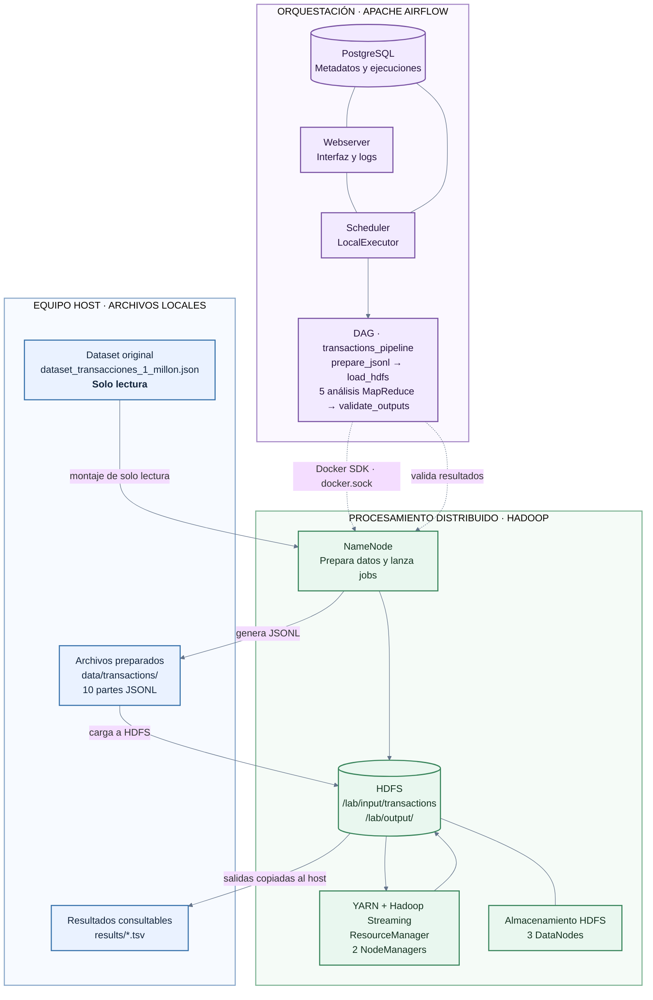

# Pipeline de transacciones: Airflow + Hadoop + HDFS

Proyecto local de procesamiento distribuido con Docker Compose, Apache Airflow y Hadoop 3.3.6. Airflow coordina
el flujo; Hadoop Streaming ejecuta cinco análisis MapReduce sobre el dataset de un millón de transacciones.

## Arquitectura



### Componentes

| Componente                             | Responsabilidad                                                                          |
| -------------------------------------- | ---------------------------------------------------------------------------------------- |
| Airflow webserver (`localhost:8080`) | Interfaz para ver el DAG, lanzarlo y consultar logs/estado de cada tarea                 |
| Airflow scheduler                      | Programa y administra tareas; usa `LocalExecutor` para este laboratorio                |
| PostgreSQL                             | Guarda metadatos de Airflow: DAG runs, estados, usuarios y tareas; no guarda el dataset  |
| NameNode                               | Prepara el JSONL, recibe comandos del DAG, accede al dataset y ejecuta el cliente Hadoop |
| HDFS / DataNodes                       | Guarda las partes de entrada y los resultados distribuidos                               |
| YARN / NodeManagers                    | Ejecuta los mappers y reducers de cada análisis                                         |

Airflow se comunica con el NameNode mediante la API local de Docker (`/var/run/docker.sock`) para ejecutar los
comandos del flujo. Esta configuración es práctica para un laboratorio en una sola máquina, pero el socket concede
control amplio sobre Docker: úsala solo en un entorno local confiable, no la expongas a Internet ni la copies tal
cual a producción.

## Datos y persistencia

El archivo original debe estar en la carpeta padre de `hdfs-mapreduce-lab/`, como en este workspace. Docker lo monta
en el NameNode como `/lab/source/dataset_transacciones_1_millon.json` **en solo lectura**. El DAG no modifica ni
reemplaza el original.

La tarea `prepare_jsonl` convierte por streaming el arreglo JSON (una sola línea) en archivos JSONL con 100.000
registros por archivo. Así Hadoop puede dividir la entrada en splits y ejecutar múltiples mappers. Las partes se
guardan localmente en `data/transactions/` y se cargan a HDFS en `/lab/input/transactions/`. HDFS almacena sus
bloques en los volúmenes de Docker de los DataNodes.

Cada job guarda su salida en HDFS bajo `/lab/output/<nombre-del-job>/`; además, se copia un TSV a `results/` para
consultarlo desde el host. La base de datos de Airflow y los logs de tareas tienen volúmenes propios.

`make down` detiene y elimina los contenedores, pero conserva los volúmenes y datos. `make clean` elimina también
los volúmenes de HDFS/PostgreSQL/Airflow, las partes generadas y los resultados locales.

## Inicio rápido

Requisitos: Docker Desktop con el motor iniciado, Docker Compose v2 y al menos 8 GB de RAM disponibles para Docker.
La primera construcción descarga Hadoop y la imagen de Airflow. Ejecuta los comandos desde `hdfs-mapreduce-lab/`,
la carpeta que contiene `docker-compose.yml`. En Windows PowerShell, si abriste la carpeta padre del proyecto,
entra primero con `Set-Location .\hdfs-mapreduce-lab`.

### Windows PowerShell

No necesitas `make` para iniciar el proyecto desde PowerShell. Crea `.env` solo si todavía no existe y cambia
la contraseña de desarrollo antes de iniciar Airflow:

```powershell
if (-not (Test-Path .env)) { Copy-Item .env.example .env }

# Construye y levanta Hadoop
docker compose up -d --build

# Levanta Airflow y espera a que sus servicios estén listos
docker compose --profile airflow up -d --build --wait airflow-webserver airflow-scheduler

# Activa y dispara el DAG
docker compose --profile airflow exec airflow-webserver airflow dags unpause transactions_pipeline
docker compose --profile airflow exec airflow-webserver airflow dags trigger transactions_pipeline
```

Puedes comprobar el estado con `docker compose --profile airflow ps`. Abre [http://localhost:8080](http://localhost:8080)
e inicia sesión con las credenciales definidas en `.env`.

### Git Bash o WSL2

En Windows también puedes usar Git Bash o WSL2 con la integración de Docker Desktop habilitada. Los atajos de
`make` requieren además tener GNU Make instalado:

```bash
if [ ! -f .env ]; then cp .env.example .env; fi
make airflow-up            # inicia Hadoop y Airflow; la primera vez puede tardar
make airflow-trigger       # lanza el DAG de transacciones
```

Abre [http://localhost:8080](http://localhost:8080), inicia sesión con las credenciales de `.env` y selecciona `transactions_pipeline`.
El DAG se crea pausado; actívalo y pulsa **Trigger DAG**. El comando `make airflow-trigger` lo activa si hace falta
y dispara una ejecución desde la terminal. El DAG está configurado sin calendario (`schedule=None`) porque el dataset
actual es estático: se ejecuta cuando lo disparas y no procesa el mismo millón de registros cada día por accidente.
Si el clúster ya se inició sin crear `.env`, las credenciales locales iniciales son `admin` / `admin`; en un primer
arranque nuevo, copia `.env.example` antes de iniciar los servicios y define una contraseña propia.

El DAG contiene tareas encadenadas para que los jobs no compitan entre sí por los recursos limitados del clúster.
Airflow reintenta una vez las tareas que fallan, y `validate_outputs` compara las cinco salidas con un recálculo
independiente. El run solo termina exitosamente si la validación pasa.

### Ejecución manual sin Airflow

El flujo Hadoop anterior sigue disponible:

```bash
make up
make load
make jobs
make verify
make test-local
```

## Análisis MapReduce

Los archivos de `results/*.tsv` incluyen una fila de encabezados para identificar cada valor:

| Job                 | Qué muestran las columnas                                                                      |
| ------------------- | ----------------------------------------------------------------------------------------------- |
| `avg_by_category` | Categoría, promedio por transacción (COP), monto total (COP), cantidad de transacciones       |
| `peak_hours`      | Hora del día, cantidad de transacciones en esa hora                                            |
| `top_merchants`   | Comercio, cantidad de transacciones (los 10 más frecuentes)                                    |
| `fraud_by_city`   | Ciudad, transacciones fraudulentas, total de transacciones, proporción de fraude (entre 0 y 1) |
| `payment_methods` | Método de pago, cantidad de transacciones, monto total (COP)                                   |

Los combiners agregan sumas y conteos (no promedios parciales). Los registros inválidos se omiten y se registran en
contadores de Hadoop.

## Configuración

Las variables opcionales están en `.env.example`; copia el archivo a `.env` y cambia la contraseña antes de iniciar
Airflow:

| Variable                   | Uso                                                                                                              |
| -------------------------- | ---------------------------------------------------------------------------------------------------------------- |
| `AIRFLOW_ADMIN_USERNAME` | Usuario administrador de la UI (por defecto `admin`)                                                           |
| `AIRFLOW_ADMIN_PASSWORD` | Contraseña local de la UI (el ejemplo es solo para desarrollo)                                                  |
| `AIRFLOW_UID`            | UID con el que corre Airflow en Linux                                                                            |
| `DOCKER_GID`             | Grupo dueño del socket Docker en Linux/WSL; si hay error de permisos, usa `stat -c '%g' /var/run/docker.sock` |

El usuario se crea durante la inicialización de Airflow y no se duplica si ya existe. Si cambias la contraseña en
`.env` después de que ese usuario fue creado, actualízala en Airflow o elimina la base de datos **solo si aceptas
perder el historial y usuarios** (`make clean` borra todos los volúmenes).

## Comandos útiles

```bash
make airflow-up        # iniciar Hadoop y Airflow
make airflow-trigger   # disparar transactions_pipeline
make airflow-down      # detener Airflow sin borrar su base de datos
make verify            # validar las salidas existentes
make down              # detener todos los contenedores, conservar volúmenes
make clean             # eliminar contenedores, volúmenes y datos generados
```

Interfaces del clúster: HDFS [http://localhost:9870](http://localhost:9870), YARN [http://localhost:8088](http://localhost:8088) e historial MapReduce
[http://localhost:19888](http://localhost:19888).

Para consultar una salida en HDFS: `docker exec namenode hdfs dfs -cat /lab/output/top_merchants/part-*`.
Las copias de resultados locales están en `results/*.tsv`.

## Preguntas frecuentes

**¿Airflow procesa o guarda el JSON?**
No. Airflow coordina tareas. El NameNode lee el JSON original montado en solo lectura, lo convierte a JSONL y
Hadoop procesa las partes en HDFS.

**¿Dónde se guardan los datos?**
El original permanece en su ubicación; las partes convertidas quedan en `data/transactions/`; la entrada procesable
y las salidas de jobs quedan en HDFS, respaldado por volúmenes Docker; las salidas TSV también quedan en `results/`.
PostgreSQL solo guarda metadatos de Airflow.

**¿Qué pasa si falla un job?**
Airflow muestra el log de esa tarea y la reintenta una vez. Si sigue fallando, las tareas posteriores quedan
bloqueadas y el DAG aparece como fallido; corrige la causa y vuelve a dispararlo.

**¿Se ejecuta automáticamente cada día?**
No. El dataset es estático y el DAG es manual para evitar reprocesar la misma entrada sin necesidad. Si luego se
incorporan archivos nuevos periódicamente, se puede definir un calendario o un sensor de archivos.

**¿Puedo correr solo Hadoop?**
Sí. Usa `make up`, `make load`, `make jobs` y `make verify`; Airflow es opcional.

**¿Cómo borro Airflow sin borrar el historial?**
`make airflow-down` detiene sus servicios y conserva PostgreSQL. `make down` detiene todo y conserva los volúmenes.
`make clean` sí elimina los volúmenes, el historial y los resultados generados.

## Tolerancia a fallos (experimentos del laboratorio)

Ejecuta estos experimentos con el clúster levantado y los datos ya cargados (`make up` y `make load`).
Cada experimento detiene o reinicia un contenedor Hadoop y luego lo inicia de nuevo; no ejecutes `make clean`
durante la prueba. El nodo `datanode2` es el objetivo predeterminado del primer experimento.

### Git Bash o WSL2

Desde la carpeta del proyecto (`hdfs-mapreduce-lab/`), captura la salida completa de cada experimento:

```bash
set -o pipefail
mkdir -p evidence/fault-tolerance
make ft-datanode 2>&1 | tee evidence/fault-tolerance/01-datanode.log
make ft-put 2>&1 | tee evidence/fault-tolerance/02-restart-datanode-during-put.log
./scripts/05_ft_nodemanager.sh 0.0005 2>&1 | tee evidence/fault-tolerance/03-nodemanager-during-mapreduce.log
make verify 2>&1 | tee evidence/fault-tolerance/04-cluster-after-tests.log
```

`set -o pipefail` hace que un fallo del comando también se refleje en el código de salida del pipeline.
El argumento `0.0005` reduce la pausa por línea para que el job de prueba no tarde demasiado; `make ft-nodemanager`
usa el valor predeterminado más lento (`0.005`).

### Windows PowerShell

Desde la carpeta del proyecto, también puedes ejecutar los mismos scripts con Git for Windows Bash y guardar
sus salidas en archivos:

```powershell
New-Item -ItemType Directory -Force .\evidence\fault-tolerance | Out-Null
& 'C:\Program Files\Git\bin\bash.exe' -c 'set -o pipefail; ./scripts/04_ft_datanode.sh 2>&1 | tee evidence/fault-tolerance/01-datanode.log'
if ($LASTEXITCODE -ne 0) { throw 'Falló el experimento DataNode' }

& 'C:\Program Files\Git\bin\bash.exe' -c 'set -o pipefail; ./scripts/06_ft_restart_put.sh 2>&1 | tee evidence/fault-tolerance/02-restart-datanode-during-put.log'
if ($LASTEXITCODE -ne 0) { throw 'Falló el experimento de escritura HDFS' }

& 'C:\Program Files\Git\bin\bash.exe' -c 'set -o pipefail; ./scripts/05_ft_nodemanager.sh 0.0005 2>&1 | tee evidence/fault-tolerance/03-nodemanager-during-mapreduce.log'
if ($LASTEXITCODE -ne 0) { throw 'Falló el experimento NodeManager' }

& 'C:\Program Files\Git\bin\bash.exe' -c 'set -o pipefail; ./scripts/03_verify.sh 2>&1 | tee evidence/fault-tolerance/04-cluster-after-tests.log'
if ($LASTEXITCODE -ne 0) { throw 'Falló la verificación posterior' }
```

### Qué observar

1. **DataNode apagado (`make ft-datanode`)**: detiene `datanode2`; el NameNode debe marcarlo como muerto,
   volver a replicar los bloques de `/lab/input/transactions` y permitir leer los datos con el mismo MD5.
   Luego el script vuelve a iniciar el DataNode. La comprobación de réplicas se limita a ese directorio para
   no confundir bloques de otros directorios con la entrada del experimento.
2. **Reinicio durante escritura (`make ft-put`)**: reinicia `datanode3` mientras se escribe un archivo de prueba
   en HDFS; el `put` debe terminar y el MD5 almacenado en HDFS debe coincidir con el local. El archivo temporal
   se elimina al terminar.
3. **NodeManager interrumpido durante MapReduce (`./scripts/05_ft_nodemanager.sh 0.0005`)**: mata abruptamente
   un NodeManager mientras corre un job lento, observa el estado del nodo y el resultado/reintentos del job, y
   vuelve a iniciar el contenedor. Consulta también los logs del job y la interfaz de YARN.
4. **Verificación final (`make verify`)**: comprueba contenedores, HDFS, YARN, aplicaciones y los resultados
   existentes del pipeline.

Las capturas de consola quedan en `evidence/fault-tolerance/`; la carpeta también puede incluir capturas PNG de
las interfaces HDFS/YARN. El experimento del NodeManager y el de escritura generan además logs del cliente en
`results/ft_slow_job.log` y `results/ft_put.log`. Conserva las evidencias de una corrida antes de repetirla.
HDFS/YARN realizan la recuperación; Airflow no sustituye esos mecanismos.

### Evidencias de la corrida

- [Caída de DataNode: detección, re-replicación y MD5](./evidence/fault-tolerance/01-datanode.log):
  se observó `live=2`, `dead=1`, los bloques under-replicated pasaron de 12 a 0 y el MD5 antes/después coincidió.
- [Reinicio durante escritura HDFS](./evidence/fault-tolerance/02-restart-datanode-during-put.log):
  el `put` de 300 MB terminó con código 0, el cliente excluyó el DataNode reiniciado y el MD5 local/HDFS coincidió.
- [Fallo de NodeManager durante MapReduce](./evidence/fault-tolerance/03-nodemanager-during-mapreduce.log):
  YARN marcó el nodo como `LOST`; el job finalizó `SUCCEEDED`, con tareas Map/Reduce relanzadas, y el contenedor se inició de nuevo.
- [Verificación final del clúster y resultados](./evidence/fault-tolerance/04-cluster-after-tests.log):
  los cinco análisis del dataset pasaron la validación independiente de un millón de transacciones.
- Capturas de las [aplicaciones YARN](./evidence/fault-tolerance/05-yarn-applications.png),
  los [tres DataNodes recuperados](./evidence/fault-tolerance/06-hdfs-datanodes-recovered.png) y
  el [job MapReduce exitoso](./evidence/fault-tolerance/07-yarn-job-success.png).

Nota: el `fsck /` global reporta 6 bloques under-replicated en archivos temporales de envío de jobs bajo
`/tmp/hadoop-yarn/staging/`: esos archivos piden replicación 10, pero este laboratorio tiene 3 DataNodes (los 3
tienen una copia). No son bloques de la entrada ni de las salidas de análisis. El directorio probado en HDFS reportó
0 under-replicated y 0 corruptos.
